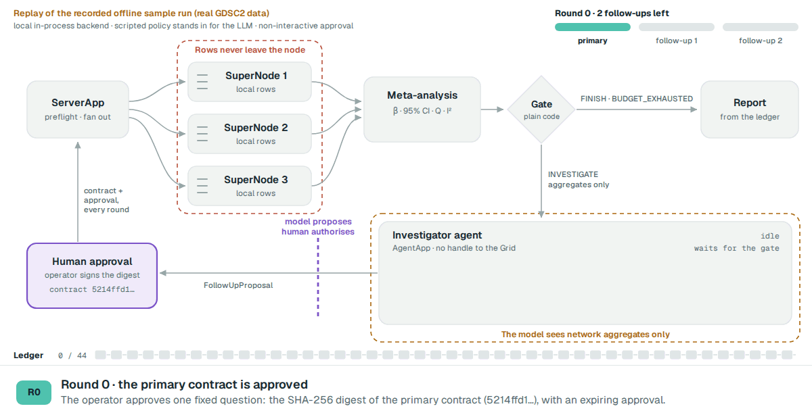

# CohortLens

Federated analytics on [Flower](https://flower.ai): one approved statistical question travels to
every site, each site answers it on its own data, and only three numbers per site come back.
If the sites disagree, a schema-bounded LLM proposes one predeclared follow-up and a human signs it off.



Step-by-step explainer with animated diagrams: [apzl.github.io/cohort-lens](https://apzl.github.io/cohort-lens/).

## What it is

Several data holders often want to answer the same question but cannot pool their records.
CohortLens sends the question instead. A coordinator distributes a hash-bound analysis contract,
each site fits the same regression locally and returns an effect, a robust standard error and a
count, and the coordinator combines them with a fixed-effect meta-analysis.

The demonstration study asks whether **BRAF p.V600E** is associated with response to **PLX-4720**
in the public GDSC2 cancer cell-line screen, split across three emulated laboratories running as
Flower SuperNodes. This is a personal project on public in-vitro data: an emulated federation, not
a patient study.

## How it works

| # | Step | Where it runs | What crosses the wire |
|---|---|---|---|
| 1 | Prepare site snapshots, contract and time-limited approval | operator CLI | nothing |
| 2 | Preflight: each site re-validates the approval against its own allowlist | ServerApp → ClientApps | `StudyPreflightRequest` → `PreflightReply` |
| 3 | Local association: OLS with HC3 robust standard errors | each ClientApp | `AssociationReply` (β, SE, N) |
| 4 | Validate replies, inverse-variance meta-analysis, Cochran Q and I² | ServerApp | `AssociationResult` |
| 5 | Deterministic gate: finish, investigate (I² ≥ 0.50), or stop | operator CLI | `InvestigationDecision` |
| 6 | Investigator: one LLM call on network aggregates only | AgentApp | `AgentEvidence` → `FollowUpProposal` |
| 7 | Human approval compiles a new contract with a new digest | operator CLI | `AnalysisContract` + `Approval` |
| 8 | Stratified second run (SKCM / non-SKCM) and report | ServerApp, ClientApps, AgentApp | `Phase2AssociationResult` |

Three boundaries hold throughout:

- **Rows stay on the node.** Only the allowlisted summary leaves a site.
- **The model sees aggregates only.** Site-level results are stripped before any LLM call.
- **The model proposes, a human authorises.** A follow-up runs only under a new contract digest and
  a fresh, expiring approval.

Design and trade-offs: [docs/architecture.md](docs/architecture.md).

## Technical details

- **Hash-bound contracts.** Every analysis is a frozen Pydantic model (`extra="forbid"`, no NaN/Inf),
  serialised to canonical JSON and identified by its SHA-256. Approvals bind to that digest and
  expire. Changing the variant, phenotype or template invalidates the approval.
- **Defence in depth at the site.** A ClientApp re-validates the approval and checks the request
  against a closed allowlist, minimum sample size and minimum group support before touching data.
- **Statistics without heavy dependencies.** OLS with HC3 sandwich errors is written in NumPy and
  matches `statsmodels` 0.14.5 to a relative tolerance of 1e-10, so the app bundle ships without
  SciPy or statsmodels.
- **Explicit participation states.** Missing, invalid, duplicate and identity-mismatched replies are
  recorded, never silently dropped; a result is `COMPLETE`, `PARTIAL` or `INSUFFICIENT`.
- **Closed-world LLM step.** One streamed call to Flower Endeavor, no tools. Output is parsed into a
  strict schema with `Literal` actions, checked against the parent result hash, and given one
  schema-repair retry before a hard failure.
- **Log-framed transport.** Apps emit one framed, schema-valid result line; the operator collects it
  from run logs, accepts identical replays and rejects conflicts.
- **Two self-contained bundles.** A Flower App Bundle holds either an AgentApp or a
  ServerApp + ClientApp pair, so shared code is staged into both and a test fails on drift.

## Requirements

- Python 3.11 or 3.12
- [uv](https://docs.astral.sh/uv/)
- For live runs: a Flower account with SuperGrid access and three registered SuperNodes
  ([docs/deployment.md](docs/deployment.md)). Tests and the synthetic reference need neither.

## Setup

```bash
git clone https://github.com/apzl/cohort-lens.git && cd cohort-lens
uv sync --extra test
uv run python scripts/stage_apps.py     # copy shared code into both app bundles
uv run pytest
```

## Run

```bash
# Offline: three synthetic sites, same handlers, no network
uv run cohortlens reference

# Public GDSC2: build three site snapshots, the contract, the approval and the run config
uv run cohortlens prepare-gdsc \
  --responses data/gdsc/source/GDSC2_fitted_dose_response_27Oct23.xlsx \
  --models data/gdsc/source/model_list_latest.csv.gz \
  --mutations data/gdsc/source/mutations_summary_latest.csv.gz \
  --output-dir data/gdsc/prepared --approved-by OPERATOR --valid-hours 24

# Primary run on SuperGrid, then collect the framed result from the log
uv run flwr run apps/cohort-analytics supergrid \
  --federation @ACCOUNT/FEDERATION \
  --run-config data/gdsc/prepared/analytics-run.toml --stream
uv run flwr log RUN_ID supergrid --show > data/gdsc/prepared/primary.log
uv run cohortlens collect --log data/gdsc/prepared/primary.log \
  --study-id gdsc2-plx4720-braf-v600e --query-id primary-001 \
  --contract-hash CONTRACT_HASH --output data/gdsc/prepared/primary-result.json
```

The gate, investigator, approval and follow-up commands are in [docs/usage.md](docs/usage.md).

## Outputs

| Path | Content |
|---|---|
| `data/gdsc/prepared/site-{1,2,3}.npz` | Site-local design matrix and outcome, one per SuperNode |
| `data/gdsc/prepared/manifest.json` | Source checksums, counts, partition rule, assignment digest |
| `contract.json`, `approval.json`, `analytics-run.toml` | Hash-bound contract, expiring approval, run config |
| `primary-result.json` | Pooled β, SE, 95% CI, Q, I², per-site status |
| `investigation-decision.json` | Gate outcome |
| `followup-proposal.json`, `followup/` | Validated proposal and the approved follow-up contract |
| `report.html` | Static report for a primary or follow-up result |

`data/` and `runs/` are git-ignored; source data never enters the repository or a bundle.

## Project layout

```
shared/cohortlens_shared/        single source of truth, staged into both apps
  schemas.py                     contracts, approvals, results, gate, evidence reduction
  statistics.py                  OLS-HC3, fixed-effect meta-analysis, synthetic generator
  gdsc.py                        GDSC2 snapshot preparation and partitioning
apps/cohort-analytics/           Flower FederatedApp bundle
  cohortlens_analytics/
    server_app.py                coordinator: preflight, fan-out, validation, meta-analysis
    client_app.py                site: allowlist checks, local regression
  cohortlens_shared/             generated copy, do not edit
apps/cohort-agent/               Flower AgentApp bundle
  cohortlens_agent/agent_app.py  investigator and reporter modes, strict output validation
  cohortlens_shared/             generated copy, do not edit
operator/cohortlens_operator/    `cohortlens` CLI
  cli.py                         prepare, collect, gate, approve
  result_frames.py               framed result extraction from run logs
  agent_frames.py                framed proposal extraction
  report.py                      static HTML reports
  fab.py                         bundle content inspection
scripts/stage_apps.py            copies shared/ into both apps, verifies the digest
tests/                           59 offline tests against a fake Flower Grid
docs/                            explainer page, architecture, usage, results, deployment
```

## Tests

```bash
uv run pytest
```

59 tests, offline, about 3 seconds. They cover contract and approval binding, site refusals,
partial participation, the gate, proposal validation, bundle packaging, and the numerical
cross-check against statsmodels.

## Results

| Run | Sites | Pooled β | 95% CI | I² | Gate |
|---|---|---|---|---|---|
| GDSC2 primary, SuperGrid | 3 of 3 (N = 291 / 306 / 341) | −2.3148 ln µM | [−2.8232, −1.8063] | 0% | `FINISH_COMPATIBLE` |
| Synthetic primary, SuperGrid | 3 of 3 (3 × 1,500 rows) | 0.5108 | | 97.1% | `INVESTIGATE` |
| Synthetic follow-up, two strata | 3 of 3 in each | 0.140 and 0.862 | | 0% in each | finished |

The GDSC2 sites agreed, so the follow-up loop was not triggered there; it has run end to end on
SuperGrid only with synthetic data. Details: [docs/results.md](docs/results.md).

## Limits

- An emulated federation: three partitions of one public dataset, not independent laboratories.
- Public cell-line assays, not patients. Associations here are not clinical findings.
- No secure aggregation or differential privacy. The coordinator sees site summaries.
- Validation catches protocol mistakes; it cannot prove a site computed honestly.
- With three sites, heterogeneity estimates are unstable.

## License

Apache-2.0
