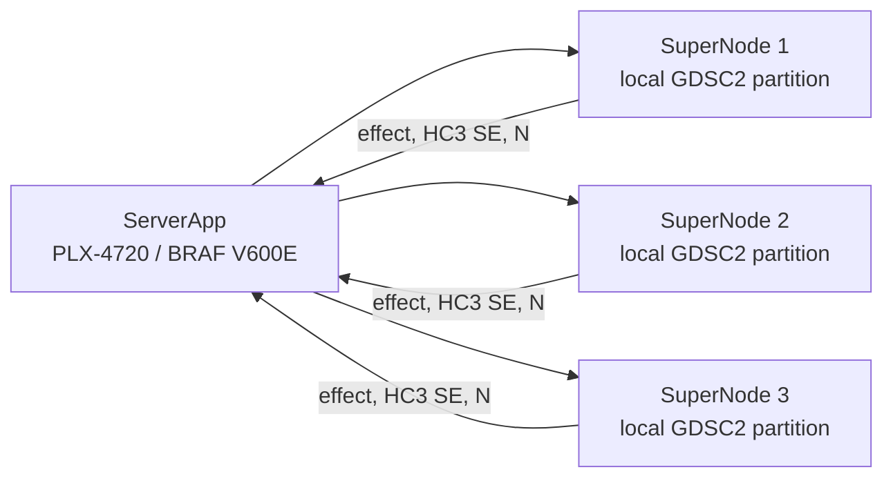

# CohortLens Analytics

CohortLens Analytics is a Flower FederatedApp for a bounded pharmacogenomics
study using public GDSC2 cancer cell-line data. It asks whether the **BRAF
p.V600E** mutation is associated with response to **PLX-4720**. Drug response is
measured as `LN_IC50`; a lower value means greater sensitivity in the assay.

This is an emulated federation over public laboratory data. It is not a patient
study, a clinical trial, or a recreation of the original GDSC institutions.

## How it works

The ServerApp sends one approved, hash-bound analysis contract to three
deployment SuperNodes. Each ClientApp:

1. validates the contract and its time-limited operator approval;
2. loads only its node-local GDSC snapshot;
3. fits the fixed OLS model with HC3 robust standard errors; and
4. returns an allowlisted summary containing the mutation coefficient,
   uncertainty, sample count, and status.

The ServerApp validates all replies and combines compatible coefficients with
inverse-variance fixed-effect meta-analysis. Raw rows, cell-line identifiers,
and design matrices are not returned to the coordinator.



If the released site estimates agree (`I² < 0.50`), the study finishes. If
they disagree and there is enough evidence, a separate CohortLens AgentApp may
propose the single predeclared follow-up: repeat the analysis separately for
SKCM and non-SKCM cancer lineages. That proposal is not authorization; an
operator must approve a new contract before another analytics run.

## Data and deployment

The input snapshots are prepared from GDSC2 release `8.5-27Oct23`, the Cell
Model Passports model list, and its compact driver-mutation summary. Each
SuperNode must receive a separate read-only NPZ snapshot and local node
configuration values for `site-alias`, `dataset-path`, and `snapshot-alias`.
Dataset paths are never placed in the run configuration or FAB.

Preparation and orchestration are provided by the full
[CohortLens repository](https://github.com/apzl/cohort-lens). Its README lists
the source files, preparation command, SuperNode configuration, contract
approval flow, and result collection commands.

Build this app from the repository root:

```shell
uv run python scripts/stage_apps.py
uv run flwr build --app apps/cohort-analytics
```

Run it on a configured deployment federation:

```shell
uv run flwr run apps/cohort-analytics supergrid \
  --federation @ACCOUNT/FEDERATION \
  --run-config data/gdsc/prepared/analytics-run.toml --stream
```

The GDSC workflow requires deployment SuperNodes with prepared local data; a
plain Flower simulation does not supply those snapshots.

## Scope and limitations

This workflow estimates an association in public, in-vitro cancer cell-line
assays. It does not establish a drug effect in people, clinical benefit,
causality, or a clinically validated biomarker. The three partitions are
virtual laboratories rather than independent replications.

Local rows are not transmitted, but the coordinator does receive site-level
summaries. The app does not provide secure aggregation, differential privacy,
or protection from dishonest participants. The compact mutation summary also
does not justify calling the comparator group definitively BRAF wild type.
